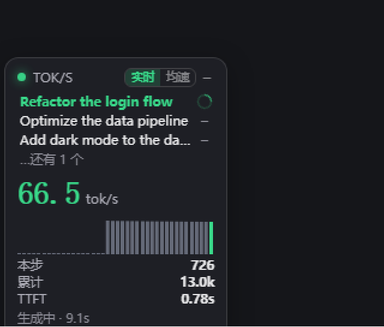

# dsh-tps-meter —— 会话实时 tok/s 悬浮窗

[](https://github.com/looking321-rt/dsh-tps-meter/actions/workflows/ci.yml)
[](https://www.npmjs.com/package/dsh-tps-meter)
[](LICENSE)

[DeepSeek Harness](https://github.com/deepseek-ai/deepseek-harness)（DSH）Web 界面里的可拖动悬浮窗：**实时显示会话输出吞吐（tok/s）**，下面是可点击切换的会话列表，再下面依次是本步 token、会话累计 token、首 token 延迟（TTFT）。



*实拍：三行会话（当前项绿字 + 转圈表示正在工作、其余白字 + `–` 表示已完成），131.6 tok/s 实时速度与 40 拍波形。*

## 环境与要求

| 项 | 要求 |
|---|---|
| **DSH** | 需要支持会话事件 firehose（`session/event`）、**实时助手流**（`agent/assistant-stream`）与页面注入（`webServer.register` / `tapIndex`）的 DeepSeek Harness 桌面版。开发与实测环境：**DSH 桌面版 0.2.0-rc.2**（`@deepseek-ai/*` 0.2.0-rc.2），Web 界面 |
| **操作系统** | 宿主逻辑跨平台（Windows / macOS / Linux 均可）；`install.ps1` 一键安装脚本仅 Windows，其它平台用两条命令手动装（见下文） |
| **运行时依赖** | **零第三方依赖**：宿主侧只用 Node 内置模块（`fs` / `path` / `url`），浮窗是纯 ES5 脚本（无框架、无构建） |
| **Node** | 宿主插件运行在 DSH 进程内，不单独跑 Node；代码只用 ES2020 语法，DSH 自带运行时即可 |
| **浏览器** | 任意现代浏览器（Chrome / Edge 88+、Firefox 78+、Safari 14+）：用到 `fetch`、Canvas 2D、Pointer Events、`localStorage` |
| **权限** | 安装时需要写 `$DSH_HOME/profiles/web`（`package.json` 与 `cordis.patch.yml`）；宿主插件运行期只**读**会话事件，不写会话日志、不发模型请求 |
| **网络** | 不需要外网；浮窗轮询的是本机 `127.0.0.1` 上的 DSH Web 服务 |

> 兼容性说明：宿主若缺少较新的字段（例如会话标题 `session/title`、`active` 整轮状态），浮窗会自动降级显示（回退到目录名、回退用"最近有无输出"判断工作状态），不会报错。

### 能在哪些环境运行

| 环境 | 支持 | 说明 |
|---|---|---|
| **DSH 桌面版** | ✅ | 默认就带 Web 运行时与 `webServer` 服务 |
| **DSH CLI 版 + 浏览器界面**（`npm i -g @deepseek-ai/dsh` 后跑 `dsh web`）| ✅ | 与桌面版共用同一个 profile（`~/.dsh/profiles/web`）和同一套 Web 运行时 |
| 纯终端 / headless（不起 Web 服务）| ❌ | 浮窗靠往页面注入脚本显示，没有页面就没有落点 |
| 其他 AI 客户端（Claude Code / Cursor / Codex CLI 等）| ❌ | 不是 DSH 插件体系，没有 `session/event` 与 `webServer` 这两套扩展点 |

只依赖两项宿主能力：**实时助手流 + 会话事件 firehose**（`agent/assistant-stream`、`session/event`）与 **Web 服务扩展点**（`ctx.webServer.register` / `tapIndex`）。

### 权限与隐私

| 项 | 说明 |
|---|---|
| 读取 | 实时吞吐订阅 `agent/assistant-stream`（模型每吐一个 chunk 一帧，`frame.chunk` 是原始分片）；生命周期与精确 usage 订阅 `session/event`：`turn/start`、`step/start`、`turn/end`、`assistant/attempt`、`assistant/message`、`tool/call`、`tool/result`、`session/title` |
| 不写 | 不改会话日志、不注入提示词、不发起模型请求、不读取工作区文件 |
| 网络 | 宿主侧不联网；浮窗只轮询本机 `127.0.0.1` 上的 DSH 服务，不访问任何第三方服务 |
| 本地存储 | 仅浮窗偏好写入浏览器 `localStorage`：位置、折叠状态、速度口径、选中的会话、已关闭的会话列表 |
| 会话数据去向 | 只在本机内存中换算成 tok/s 展示，不落盘、不外发、不做统计上报 |

## 开源 / 仓库

- 许可证：**MIT**（见 [LICENSE](LICENSE)）
- 变更记录：[CHANGELOG.md](CHANGELOG.md)
- CI：GitHub Actions 在 Node 20 / 22 上跑 `node --test`（见 `.github/workflows/ci.yml`）

```
┌─────────────────────────┐
│ ● TOK/S   [实时│均速] – │   ← 右上角按钮切换速度口径
│ Refactor the login flow │   ← 当前会话（绿字）
│ Optimize the data pipe… │   ← 其他会话（白字，点一下切过去）
│ Add dark mode to the …  │   ← 名字过长自动截断
│ …还有 2 个              │   ← 最多显示 3 行，其余折叠成一行
│ 71.7 tok/s              │   ← 实时 = 窗口速度（绿）；均速 = 本步平均（蓝）
│ ▁▂▃▅▆▇█▇▆▅▃▂▁▂▃▅▆▇      │   ← 波形只在实时口径显示
│ 本步            414     │
│ 累计           12.7k    │
│ TTFT           0.78s    │
│ 生成中 · 6.8s           │   ← 空闲时整行收起
└─────────────────────────┘
```

## 功能

| 项 | 说明 |
|---|---|
| 速度口径按钮 | 右上角 `实时 / 均速` 分段按钮**手动**切换，不再自动跳 |
| 数字配色 | **只跟口径走**：实时 = 绿色、均速 = 蓝色（完全无会话数据时才中性灰）|
| 会话列表 | 纵向堆叠会话名（取 `session/title`）；**当前会话绿色、其余白色，点名字即切换**；名字过长省略号截断；最多 3 行，超出显示 `…还有 N 个`（悬停可见全部）；选择记在 localStorage。宿主还没提供标题时回退为 `目录名 · #短id`（至少能区分同目录下的不同会话）|
| 行内状态标 | 每行最右侧：**工作中 = 绿色转圈**（Windows 式缺口环旋转）、**已完成 = `–`**。工作中的判定看整轮生命周期（`turn/start` → `turn/end`），**思考、跑工具、等工具结果的空档也算工作中**，不会因为十几秒没输出就误标成完成 |
| 双击关闭 | 双击**整轮已结束**的会话名 → 从浮窗移除它（记 localStorage）；**整轮进行中双击无效**；列表底部出现 `…N 个已关闭（点此恢复）`，点一下全部找回；被关会话重新开始干活会自动回到列表 |
| 实时 tok/s | 窗口内估算 token ÷ 窗口真实跨度，每 400ms 刷新 |
| 精确校正 | 每个步骤结束时用提供方上报的 `usage.outputTokens` 校正估算系数（EMA），显示值逐步贴近真值 |
| 本步 / 累计 | 当前步骤输出 token、本次会话累计输出 token |
| TTFT | 首 token 延迟（step/start → 首个非空 delta） |
| 波形 | 只在**实时**口径显示：生成中推进、停下冻结、从未输出时画一条基线 |
| 状态行 | 整轮进行中就露一行：生成中 → `生成中 · 6.8s`；无输出但有工具在跑 → `工具执行中…`；其余 → `思考中…`。整轮结束即收起 |
| 多会话排序 | 按「活跃 → 主会话 → 最近」排列，列表顺序与之一致 |
| 交互 | 头部拖动移动（位置记忆）、`–` 折叠成小胶囊、口径与折叠状态都记在 localStorage |
| 常亮 | 不再因空闲改变透明度，始终保持同一暗度；轮询失败退避到 5s、页面隐藏降到 2s |
| hover 详情 | 悬停浮窗显示完整 tooltip：会话名、两口径、轮/步、本步耗时、工作目录 |
| 自更新提示 | 每 60s 比对一次脚本版本，发现换了就在头部亮出绿色 `⟳`，点击刷新页面（只提示不自动刷新，避免打断输入） |

## 两个口径分别怎么算

| | 实时 | 均速 |
|---|---|---|
| 含义 | 此刻的瞬时速度 | 本步从头到现在的平均速度 |
| 公式 | Σ(窗口内 token) ÷ max(窗口真实跨度, 300ms)，窗口 2000ms | 本步 token ÷ (现在 − 首 token 时刻) |
| token 来源 | 流式增量按字符估算，再乘校正系数 | 生成中同上；**步骤结束改用提供方精确 `usage.outputTokens`** |
| 停下之后 | 归 0（确实没有实时输出了） | 定格为该步平均值，一直显示到最后一步 |
| 用途 | 看此刻快不快、有没有卡顿 | 看这一步整体效率（开头慢/结尾慢都摊平） |

「本步结束」的判定是收到 `assistant/message`（一步组装完成）；解码时长不足 200ms 的步骤不给均速（样本太小、噪声大）。
校正系数 = 每步「精确 outputTokens ÷ 估算值」的 EMA（限幅 0.3~3），所以跑几步之后估算口径会越来越贴近真值。

## 数据来源

宿主侧订阅**两条**通道（`ctx.on(...)`），只读、不写会话日志、不碰模型请求：

```
agent/assistant-stream   ← 实时主数据源：模型每吐一个 chunk 一帧
   frame.type: start | chunk | end
   frame.chunk: text-delta / reasoning-delta / tool-call-delta / usage / finish …
   frame.index: attempt 内自增序号（天然增量，不会重复计数）
        │
session/event            ← 生命周期与精确 usage
   step/start · turn/start · turn/end · session/title（会话标题）
   tool/call · tool/result
   assistant/attempt · assistant/message（提供方精确 usage，用于估算校正）
        │
        ▼
  tracker.js  滑动窗口 + 估算校正
        │
        ▼
  GET /dsh-tps/state.json   ← 浮窗每 400ms 轮询
```

> **为什么实时读数不会重复计数**：两条通道职责分离——`agent/assistant-stream` 是
> **逐 chunk 的增量**，负责实时窗口；`session/event` 里的 `assistant/message` 携带的
> `data.stream` 是**该步完整累积的快照**（同一份内容会整份重复出现），因此当某一步
> 已由实时通道供数时，结算事件只取精确 `usage.outputTokens`、**绝不再遍历快照**。
>
> 该实时通道按 agent 作用域路由（`dsh-scope` 的解析器取 `args[0].agent`），插件挂在
> 应用根上下文、不在任何 agent 作用域内，故订阅时**必须**带 `{ global: true }`，
> 否则 Cordis 的作用域过滤会让插件一帧都收不到（静默失效）。

兼容性：更老的宿主若只发旧式 `assistant/chunk` 增量事件，插件仍会处理它（该分支保留）。

token 估算启发式：ASCII 4 字符 ≈ 1 token，非 ASCII 字符（中文等）≈ 0.6 token；随后由提供方 usage 自动校正。

## 安装

### 从 npm 安装（最省事）

```powershell
dsh plugin --profile web add dsh-tps-meter
```

> 需要先装 DSH 官方 CLI（桌面版不带）：`npm i -g @deepseek-ai/dsh`，装完重开终端。
> 没有 CLI 的话用下面的源码方式，效果一样。

### 从 GitHub 源码安装

```powershell
git clone https://github.com/looking321-rt/dsh-tps-meter.git
cd dsh-tps-meter
& .\install.ps1                 # 卸载：& .\install.ps1 -Remove
```

脚本做两件事：`pnpm add "dsh-tps-meter@link:<本仓库>"`，以及把 `dsh-tps-meter` 写进
`~/.dsh/profiles/web/package.json` 的 `dsh.profile.bundles`（改前自动备份 `*.bak-tps-*`）。

> 内部用 **pnpm** 链接依赖；没装的话先 `npm i -g pnpm`（插件本身零依赖，这里只是借用包管理器做 link）。

macOS / Linux 手动两步：

```bash
cd ~/.dsh/profiles/web
pnpm add "dsh-tps-meter@link:$HOME/dsh-tps-meter"     # 1) 链接本仓库
# 2) 在 package.json 的 dsh.profile.bundles 数组里加一项 "dsh-tps-meter"
```

**登记只放一处**：`dsh.profile.bundles` —— 这是 DSH 自己管理 bundle 层的地方，它会在每次
`dsh plugin ...` 之后按包的 `dsh.bundle` 声明核对这个列表。**别**再往 `cordis.patch.yml` 里手写
同名的 `- insert:` 行：那会变成两份登记，删除时清掉一份、另一份悬空，DSH 下次启动就会
`cannot resolve profile bundle "dsh-tps-meter"` → `plugin tree failed to load` → 进程在监听端口前退出
（桌面端表现：「dsh 子进程在就绪前退出」，整个界面都连不上）。

### 用 DSH CLI 安装本地源码

```powershell
dsh plugin --profile web add link:<本仓库的绝对路径>
# 例如：dsh plugin --profile web add link:D:\code\dsh-tps-meter
```

装完**重启一次 DSH**（bundle 层在启动时加载），再刷新页面即可看到浮窗：注入发生在 HTML 响应时，SPA 内部切页不会重新加载脚本。

> ⚠️ DSH 桌面应用里 **F5 无效**：刷新用 **Ctrl+R**，或菜单 **文件 → 重新加载页面**（asar 主进程里只绑定了 `CmdOrCtrl+R`）。

## 卸载

```powershell
cd <本仓库路径>
& .\install.ps1 -Remove
```

卸载会清干净三处登记（`dsh.profile.bundles`、`cordis.patch.yml` 里的历史遗留行、`dependencies`），
而且是**幂等**的：重复跑不报错，也不会碰别的插件的行。

**DSH 已经起不来了怎么办**：若删除时漏清了某处登记（旧版脚本、或手动删过目录），DSH 会在加载插件树时
直接退出。在仓库目录跑一次 `& .\install.ps1 -Remove` 就能救回来 —— 它**先清登记再动 pnpm**，最后打印
`self-check: no dsh-tps-meter reference left in the profile`，看到这行就可以重新启动 DSH 了。

## 开发

```powershell
node --test test/               # 全部测试（tracker 14 项 + 宿主 6 项）
node test/preview.mjs           # 本地预览服务 http://127.0.0.1:8899/（mock 读数）
#   PREVIEW_MODE=done|thinking|tool|empty node test/preview.mjs   切换预览状态
#   http://127.0.0.1:8899/?view=avg                预览「均速」口径
#   http://127.0.0.1:8899/?view=live&autodbl=1     自动双击，验证「关闭会话显示」
```

改动 `lib/widget.js` 后刷新页面即生效（每次请求读磁盘），浮窗还会自己发现新版并亮出 `⟳`；改动宿主逻辑（`lib/index.js`、`lib/tracker.js`）需重启 DSH。

> 记得改 `lib/widget.js` 里的 `BUILD` 常量 —— 浮窗靠它判断"脚本换新版了没有"。

## 已知限制

- **估算不是计费口径**：无 usage 的步骤按字符启发式计价；有 usage 时按步骤校正，但步骤内瞬时值仍是估算。
- **实时口径在空闲时显示 0.0**：这是"此刻没有输出"的如实反映（数字仍是绿色，波形冻结保留）；想随时有数字就切到「均速」（它有值：生成中=本步均速，空闲=上一步均速）。
- **多标签页各自轮询**：每个打开的 DSH 页面都会拉起自己的浮窗与轮询（互不干扰）。
- **会话识别靠"最活跃"**：浮窗不读取界面当前选中的会话，只按活跃度排序（subagent 会话排在主会话之后）。
- **MS 精度**：速度基于事件时间戳（宿主与浏览器同机），跨机部署时以宿主时钟为准。
- **停用是即时的，启用要重载页面**：宿主插件被停用/卸载后，`/dsh-tps/state.json` 变为 404，浮窗在连续 3 次 404 后**自行移除并停止轮询**（宿主临时故障的 5xx / 超时不会误删，仍会继续重试）。但注入发生在**页面加载时**，所以重新启用后浮窗不会自己回来，需要重载一次页面 —— 桌面端按 `F12` 打开控制台执行 `location.reload()`（正式版桌面端没有「刷新页面」菜单，`Ctrl+R` 与 `F5` 均未绑定）。
- **插件开关与 bundle 层**：本插件以 `dsh.profile.bundles` 的组合包形式注册。插件页的**组合包开关**改的是 profile 的 `package.json`；DSH 的插件管理器在 YAML 启用 HMR 时配置变化立即生效，否则运行中的组合保留到重启（见其 `README.zh.md`）。
